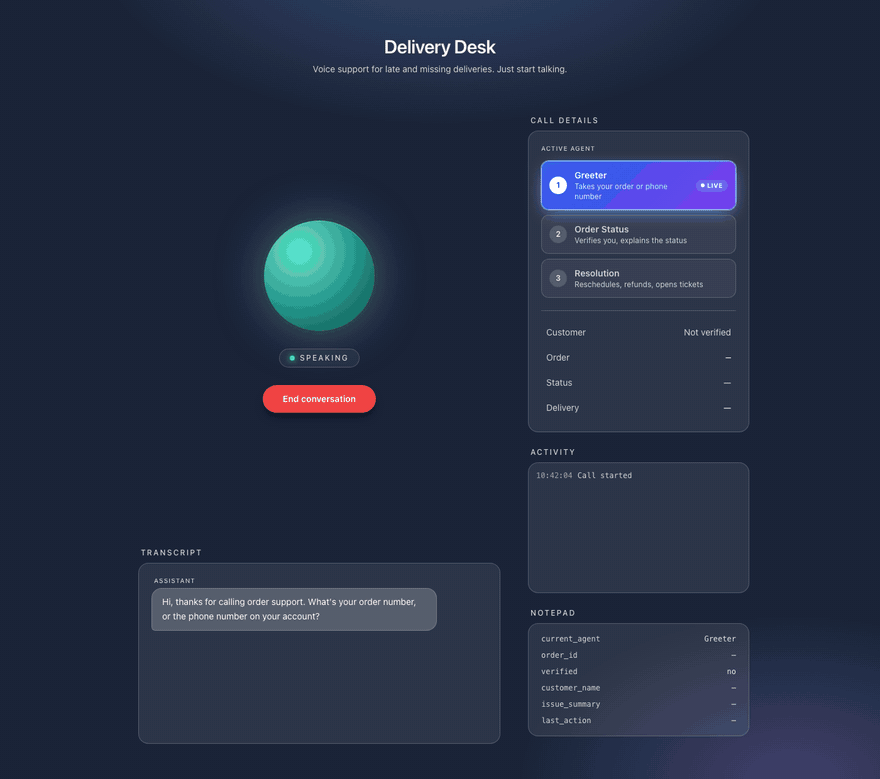
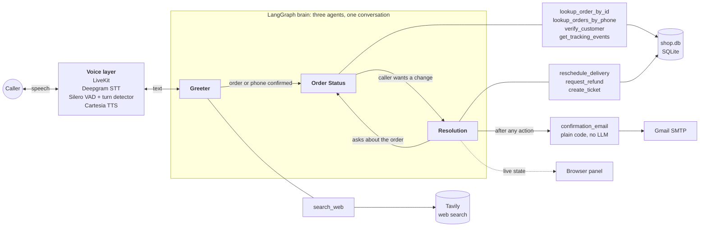
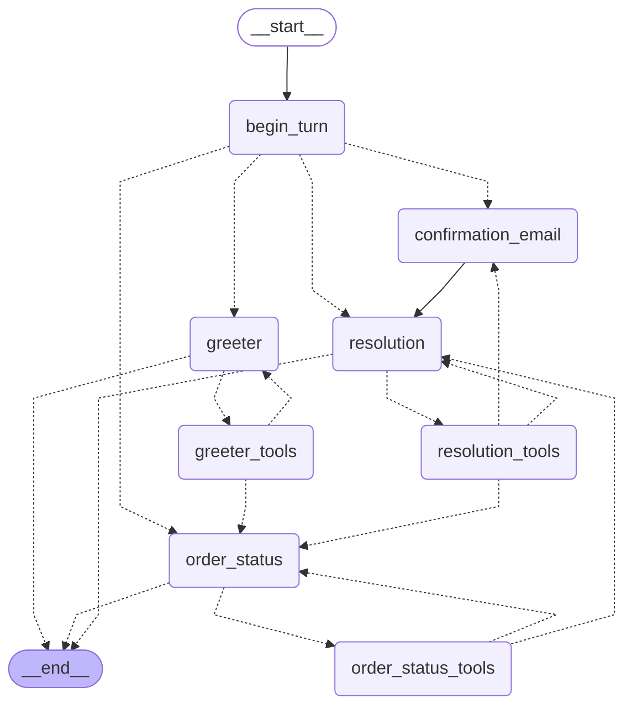

# Delivery Desk

**A voice assistant that answers "where is my order?" calls: it verifies the caller, explains the delay, fixes the problem and emails a confirmation.**



*Animated walkthrough of the browser client, replayed from a scripted sample session. The orb shows the call state, and the side panel shows the active agent, the verified customer, every tool call and the shared call data. A caller interrupts the agent mid-sentence about halfway through.*

Built on a LangGraph graph of three specialist agents (Greeter, Order Status, Resolution) with a LiveKit voice, Deepgram speech-to-text and Cartesia text-to-speech. Callers can pause mid-thought and interrupt at any time.

## Built with


## What it does

- **Verifies the caller** with the last four digits of the phone number on the order, enforced in code, not just in the prompt.
- **Explains the order** in plain spoken language, including why it's late, using the tracking history and the delay reason.
- **Acts on the caller's request:** reschedules a delivery, opens a refund request or support ticket, or escalates to a human.
- **Confirms by email** after any change, and says honestly if the email failed.
- **Hands off between three specialist agents** (Greeter, Order Status, Resolution) in a LangGraph graph, while the caller experiences one continuous conversation.
- **Handles real conversation:** it waits when you pause mid-thought and stops talking the moment you interrupt.
- **Shows its work:** a live panel makes every hand-off and tool call visible.

All customer and order data is fake and for demo purposes only.

## Setup and run

**You need:** [uv](https://docs.astral.sh/uv/) (it installs Python 3.11 for you), a browser, and these API keys:

| Key in `.env` | Where to get it | Required |
|---|---|---|
| `LIVEKIT_URL`, `LIVEKIT_API_KEY`, `LIVEKIT_API_SECRET` | A free project at [cloud.livekit.io](https://cloud.livekit.io), under Settings, Keys | Yes |
| `ANTHROPIC_API_KEY` | [console.anthropic.com](https://console.anthropic.com) | Yes |
| `DEEPGRAM_API_KEY` | [console.deepgram.com](https://console.deepgram.com) | Yes |
| `CARTESIA_API_KEY` | [play.cartesia.ai](https://play.cartesia.ai) | Yes |
| `GMAIL_ADDRESS`, `GMAIL_APP_PASSWORD` | A [Google app password](https://myaccount.google.com/apppasswords) | For confirmation emails. Without them the agent tells the caller the email didn't go through. |
| `TAVILY_API_KEY` | [tavily.com](https://tavily.com) | For web search. Without it the Greeter simply skips search. |

**1. Install, from a fresh clone:**

```bash
git clone https://github.com/debarchan19/voice-agent.git
cd voice-agent
uv venv --python 3.11 --managed-python
source .venv/bin/activate
uv pip install -r requirements.txt
cp .env.example .env            # then fill in your keys
python agent.py download-files  # one-time: turn detector and VAD models
python seed.py                  # creates shop.db with 10 customers and 10 orders
```

**2. Run, in three terminals** (activate the virtual environment in each of the first two):

```bash
python agent.py dev                       # terminal 1: the voice agent
uvicorn token_server:app --port 8000      # terminal 2: issues browser tokens
open index.html                           # terminal 3: or just open the file in your browser
```

Click **Start conversation**, allow the microphone, and try an order from the [test orders](#test-orders) below.

## Test orders

The data is the same on every seed, and dates are relative to the day you run `seed.py`. Re-run it to undo reschedules and tickets.

| Order ID | Status | Item | Customer | Verify with (last 4) |
|---|---|---|---|---|
| ORD-48213 | delayed: weather hold at the Denver hub | Stainless steel espresso machine | Maya Patel | 0142 |
| ORD-51907 | delayed: carrier backlog | Noise-cancelling headphones | James Carter | 0187 |
| ORD-36458 | delayed: address issue, apartment number missing | Ergonomic office chair | Sofia Ramirez | 0123 |
| ORD-72041 | out for delivery | Robot vacuum cleaner | Daniel Kim | 0168 |
| ORD-19376 | delivered | Cast iron skillet set | Maya Patel | 0142 |
| ORD-60582 | delivered | Trail running shoes | Aisha Johnson | 0119 |
| ORD-27719 | cancelled | Adjustable standing desk | Lucas Moreau | 0156 |
| ORD-83350 | returned | Insulated winter parka | Priya Nair | 0131 |
| ORD-44926 | processing | Mechanical keyboard | Ethan Brooks | 0174 |
| ORD-95063 | shipped | Digital air fryer | Hannah Weber | 0109 |

To try the phone-number path, give Maya's full number, **720-555-0142**. It has two orders: ORD-48213 and ORD-19376.

## Stack

| Part | Choice | Why |
|---|---|---|
| Agent orchestration | LangGraph 1.2 | An explicit graph of agents, tools and hand-offs that can be drawn, checkpointed and unit tested |
| LLM access | LangChain (`langchain-anthropic`) | Streaming and tool calling through one interface, so the graph isn't tied to a provider |
| Realtime voice | LiveKit Agents 1.8 | Handles WebRTC audio, the STT → LLM → TTS pipeline and interruptions |
| Voice ↔ graph bridge | `livekit-plugins-langchain` | Lets a LangGraph graph act as the voice agent's LLM |
| Speech-to-text | Deepgram nova-3, interim results on | Fast and accurate on phone audio. Interim results let turn detection start before the caller finishes |
| Text-to-speech | Cartesia sonic-3 | Most natural Cartesia voice, about 0.2s to first audio |
| Voice activity detection | Silero VAD | Small local model that detects when someone starts and stops speaking |
| Turn detection | LiveKit English turn detector | Judges whether the caller has actually finished their thought, not just paused |
| Database | SQLite (`shop.db`) | Nothing to install, and easy to reset with `seed.py` |
| Email | Gmail SMTP via Python's `smtplib` | No extra dependency, and works with an app password |
| Web search fallback | Tavily | Answers general questions the shop's data can't, such as carrier holiday schedules |
| Browser client | `livekit-client` and Tailwind from a CDN | One HTML file, no build step |

## Architecture: a LangGraph brain behind a LiveKit voice

There are two layers, and each one only does its own job.



- **Voice layer ([agent.py](agent.py)):** LiveKit handles audio, interruptions and turn-taking. It knows nothing about orders.
- **Brain ([wismo/](wismo/)):** a LangGraph `StateGraph` decides who is talking, which tools to call and when to hand off. It knows nothing about audio.

`LLMAdapter` is the only seam. Each time the caller finishes a turn, LiveKit hands the transcript to the graph, and whatever the graph streams back is spoken.

### The graph

<!-- graph:start -->

<!-- graph:end -->

Regenerate it with `python scripts/draw_graph.py`. A test fails if the diagram is out of date.

| Node | Kind | Job |
|---|---|---|
| `begin_turn` | code, no LLM | Tidies the checkpoint against the transcript LiveKit re-sent, and picks up any action an interruption left half-recorded |
| `greeter` | LLM | Greets, collects an order or phone number, reads it back, hands off |
| `order_status` | LLM | Verifies the caller, explains the order and why it's late |
| `resolution` | LLM | Confirms out loud, then reschedules, refunds, opens a ticket or escalates |
| `*_tools` | `ToolNode` | One per agent, so an agent can only reach its own tools |
| `confirmation_email` | code, no LLM | Emails the caller after any action, built only from what was actually done |

Hand-offs are tools that return a `Command`: `transfer_to_order_status` sets `active_agent` and the next agent speaks in the same turn, so there's no dead air waiting for the caller.

| Agent | Tools |
|---|---|
| **Greeter** | `transfer_to_order_status`, `search_web`, `escalate_to_human` |
| **Order Status** | `lookup_order_by_id`, `lookup_orders_by_phone`, `verify_customer`, `get_tracking_events`, `transfer_to_resolution`, `escalate_to_human` |
| **Resolution** | `reschedule_delivery`, `request_refund`, `create_ticket`, `transfer_back_to_order_status`, `escalate_to_human` |

### State shared across the call

`CallState` (in [wismo/state.py](wismo/state.py)) is checkpointed by LangGraph and holds the active agent, order, customer, verification status, issue and last action. Every tool reads it and writes changes back in a single `Command`, so a tool's result and its state change commit together. On a hand-off, the next agent gets the conversation so far, a one-line summary of this state, and a one-shot note telling it what to do first.

### Verification is enforced in code

Nothing about an order is shared until `verify_customer` succeeds with the last four digits of the phone number on the account.

- **Before verification:** `lookup_order_by_id` only confirms the order exists, and `lookup_orders_by_phone` only returns order numbers.
- **Tracking and actions:** `get_tracking_events`, `transfer_to_resolution` and every Resolution tool raise a `ToolError` unless the call is verified for that same order. A prompt can't talk its way past this.
- **Retries:** callers get 3 attempts. The attempt is counted before the database lookup, so interrupting the agent can't hand back a free one.
- **The one exception:** `escalate_to_human` also works for unverified callers, so someone who fails verification can still reach a person. Their ticket is marked as unverified and no email is sent.

### Why `custom` stream mode

By default the adapter would speak every message any node produces, including tool results. So the agent would read "Transferred. Order ORD-48213 exists…" aloud. Instead the graph runs in `custom` mode: each specialist streams the model's words through `runtime.stream_writer`, and that is the **only** path to the caller's ears. Tool results, notes and routing never reach the speaker.

### Interruptions and consistency

LiveKit cancels the graph mid-run when the caller cuts in. Three things keep the call consistent:

- **Atomic steps.** LangGraph applies a step's results together, so a hand-off is either fully applied or not at all.
- **Idempotent side effects.** A ticket or email runs as its own task, shielded from the interruption, and is keyed per action. If the caller cuts in during a refund and the model asks again, it gets the same ticket back instead of a second one.
- **Reconciliation.** The next `begin_turn` waits for anything still in flight, records what finished, and removes tool calls that never got a result.

LiveKit's *preemptive generation* (starting a reply before the caller finishes) is turned off, because a speculative run would execute tools early.

### Model calls per turn

| Turn | Calls |
|---|---|
| Plain reply | 1 |
| Verify, status question, hand-off | 2 |
| Action plus email | 2, plus about 1 s for SMTP |

There's no router or supervisor model call: routing is plain code reading the state. Measured in a real text run, the first words came back in about 1 to 2 seconds per model call.

## How natural turn-taking works

The hard part of a voice agent is knowing when the caller has finished talking. This project uses a layered approach in place of a fixed silence timer.

**Why a silence timer isn't enough.** A simple agent waits for something like 500 ms of silence, then replies. Callers pause all the time mid-thought: "my order number is… *(looks at email)* …4 8 2 1 3." A timer cuts in during that pause and the agent answers half a sentence. If you make the timer longer to avoid that, every reply feels sluggish.

**How it works here:**
1. **Silero VAD** runs locally on the audio and marks when speech starts and stops. It's fast but only knows sound versus silence.
2. **Deepgram nova-3** streams *interim* transcripts while the caller is still speaking, so text is ready the moment they stop.
3. **The turn detector** is a small language model that reads the transcript so far and predicts whether the sentence is complete.
   - "My order number is" scores as unfinished, so the agent keeps waiting, up to a few seconds.
   - "My order number is 4 8 2 1 3" scores as finished, so the agent replies after just 0.3 seconds.

   This is *semantic* end-of-turn detection: it's based on meaning, not just silence.
4. Only then does the graph run, and Cartesia starts speaking from the first sentence while the rest is still being generated.

**Barge-in (interruptions).**
- **Stopping:** if VAD hears the caller speak while the agent is talking, LiveKit stops text-to-speech immediately and cancels the graph run.
- **Cleaning up history:** LiveKit cuts the agent's message at the point it was interrupted, so the history only contains what the caller actually heard.
- **Carrying on:** the new speech becomes the next turn, so the caller can say "actually, move it to Friday" mid-sentence and the agent adapts.

This all happens in the audio pipeline, configured in `agent.py`. It doesn't rely on the prompt asking the model to stop.

## Email

After a successful reschedule, refund request, ticket or escalation, the `confirmation_email` node sends the email. It's plain code, not something the model has to remember to call.

**How the email is built (`email_tool.py`):**
- **Content:** built from what the tool actually did (`state["last_action"]`), not from model-written text.
- **Format:** plain text plus a simple HTML version.
- **Sending:** goes through `smtp.gmail.com:465` over SSL, in a worker thread, so the conversation never stalls.
- **Failures:** they're logged and passed to the agent as a note, so it says honestly that the email didn't go through.

**Setup:** add these to `.env`:
- `GMAIL_ADDRESS`
- `GMAIL_APP_PASSWORD`: a [Google app password](https://myaccount.google.com/apppasswords), 16 characters, not your normal password.

**Safe testing:** set `DEMO_RECIPIENT_EMAIL` and every email goes to that address instead of the customer's seeded `@example.com` address.

## Keeping secrets out of git

- `.gitignore` excludes `.env`, every `.env.*` file except `.env.example`, a local `config` file and `shop.db`.
- The only environment file in the repository is [.env.example](.env.example), which holds placeholders, not real keys.
- I scanned the full git history for the keys used in development and found none. To check a clone yourself: `git ls-files | grep -E '(^|/)\.env$'` should print nothing, and `git log --all -p -S"your-key-value"` should print nothing.
- If a key ever leaks, rotate it at the provider. Removing it from git history is not enough.

## Files

| File | Purpose |
|---|---|
| `agent.py` | LiveKit voice layer: STT, TTS, VAD, turn detection, and the `LLMAdapter` around the graph |
| `wismo/graph.py` | The LangGraph graph: nodes, routing, `begin_turn` reconciliation |
| `wismo/tools.py` | All tools, the verification gate, and idempotent side effects |
| `wismo/state.py` | `CallState` (checkpointed) and `CallContext` (per-call runtime) |
| `wismo/prompts.py` | Voice rules, per-agent roles, greeting |
| `wismo/panel.py` | Publishes call state to the browser panel |
| `wismo/facts.py` | Turns database rows into speakable text |
| `db.py`, `seed.py` | SQLite schema, queries, and 10 fake customers and orders |
| `email_tool.py` | Builds and sends confirmation emails |
| `token_server.py` | FastAPI `GET /token` for the browser |
| `index.html` | Browser client: voice, live transcript, call panel |
| `docs/` | Graph diagram source, the demo GIF and a screenshot |
| `tests/` | Database, gate, email and graph tests (scripted fake model, no network) |
| `scripts/draw_graph.py` | Regenerates the graph diagram |
| `scripts/text_call.py` | A real end-to-end call as text, using the real model |

The previous version, built on LiveKit's own hand-off mechanism instead of LangGraph, is in git history at commit `2b1b370`.

## Testing

```bash
pytest -q                       # all tests; no network, no real email
python scripts/text_call.py     # a real call as text through the real model (needs your API key)
python scripts/draw_graph.py    # regenerate the diagram after changing the graph
```

The graph tests drive the real `LLMAdapter` with a scripted fake model, so routing, hand-offs, the gate, persistence and barge-in are all tested without any API.

Optionally, set `LANGSMITH_TRACING=true` and `LANGSMITH_API_KEY` in `.env` to see every graph step as a trace.
