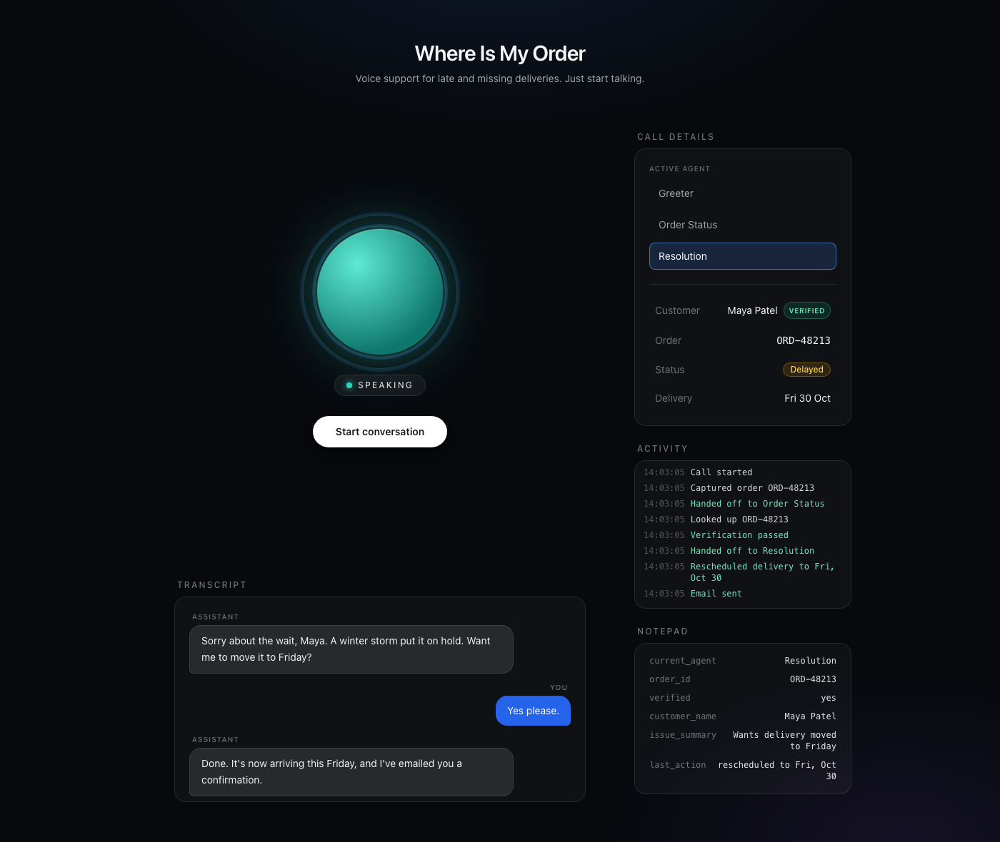
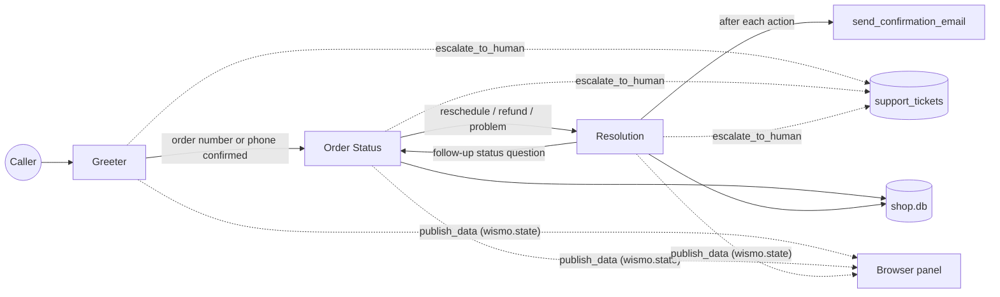

# Where Is My Order

**A multi-agent voice assistant for late and missing deliveries.** Call in, get verified, hear what happened to your package in plain speech, reschedule or request a refund, and get a confirmation email, all in one natural conversation you can interrupt at any time.



*The browser client mid-call (sample session): the orb shows the call state, and the side panel shows the active agent, the verified customer, every tool call and the shared userdata.*

## Built with


## What it does

- **Verifies the caller** with the last four digits of the phone number on the order, enforced in code, not just in the prompt.
- **Explains the order** in plain spoken language, including why it's late, using the tracking history and the delay reason.
- **Acts on the caller's request:** reschedules a delivery, opens a refund request or support ticket, or escalates to a human.
- **Confirms by email** after any change, and says honestly if the email failed.
- **Hands off between three specialist agents** (Greeter, Order Status, Resolution) while the caller experiences one continuous conversation.
- **Handles real conversation:** it waits when you pause mid-thought and stops talking the moment you interrupt.
- **Shows its work:** a live panel makes every hand-off and tool call visible.

All customer and order data is fake and for demo purposes only.

## Stack

| Part | Choice | Why |
|---|---|---|
| Realtime transport | LiveKit Agents 1.8 | Handles WebRTC audio, the STT → LLM → TTS pipeline, interruptions and agent hand-offs |
| Speech-to-text | Deepgram nova-3, interim results on | Fast and accurate on phone audio. Interim results let turn detection start before the caller finishes |
| LLM | Anthropic LLM via the LiveKit plugin (model set in `agent.py`) | Reliable tool use and natural, concise conversation at voice-friendly latency |
| Text-to-speech | Cartesia sonic-2 | Low time to first audio, with a natural voice |
| Voice activity detection | Silero VAD | Small local model that detects when someone starts and stops speaking |
| Turn detection | LiveKit English turn detector | Judges whether the caller has actually finished their thought, not just paused |
| Database | SQLite (`shop.db`) | Nothing to install, and easy to reset with `seed.py` |
| Email | Gmail SMTP via Python's `smtplib` | No extra dependency, and works with an app password |
| Web search fallback | Tavily | Answers general questions the shop's data can't, such as carrier holiday schedules |
| Browser client | `livekit-client` and Tailwind from a CDN | One HTML file, no build step |

## Architecture



The three agents in `support.py` are LiveKit `Agent` subclasses, each with its own instructions and `@function_tool` methods. A hand-off happens when a tool returns the next agent, for example `return ResolutionAgent(chat_ctx=..., userdata=...)`.

| Agent | Job | Tools |
|---|---|---|
| **Greeter** | Greets the caller and collects an order number or phone number. It reads the number back to confirm, saves it to userdata, then hands off | `transfer_to_order_status`, `search_web` |
| **Order Status** | Verifies the caller, then explains status, delays and tracking in plain speech | `lookup_order_by_id`, `lookup_orders_by_phone`, `verify_customer`, `get_tracking_events`, `transfer_to_resolution` |
| **Resolution** | Confirms out loud, then acts and emails a confirmation | `reschedule_delivery`, `request_refund`, `create_ticket`, `send_confirmation_email`, `transfer_back_to_order_status` |

All three agents also have `escalate_to_human`, which opens an escalation ticket and tells the caller a specialist will call back.

### Shared context across hand-offs

The session holds one `UserData` object (`AgentSession[UserData]`) with these fields:
- `customer_id`
- `customer_name`
- `order_id`
- `verified`
- `issue_summary`
- `current_agent`
- `last_action`

Every tool reads and writes it. On a hand-off, the next agent gets two things:
- the conversation so far, without tool calls;
- a one-line summary of the userdata in its instructions.

So the caller never repeats themselves.

### Verification is enforced in code

Nothing about an order is shared until `verify_customer` succeeds with the last four digits of the phone number on the account.

- **Before verification:**
  - `lookup_order_by_id` only confirms the order exists;
  - `lookup_orders_by_phone` only returns order numbers.
- **Tracking and actions:** `get_tracking_events` and every Resolution tool, including `send_confirmation_email`, raise a `ToolError` unless `userdata.verified` is true for that same order. A prompt can't talk its way past this.
- **Retries:** callers get 3 attempts.
- **The one exception:** `escalate_to_human` also works for unverified callers, so someone who fails verification can still reach a person. Their ticket is marked as unverified and no email is sent.

### Live call panel

On every hand-off, tool call and userdata change, the agent publishes a JSON message with `room.local_participant.publish_data` on the topic `wismo.state`:

```json
{"type": "state", "agent": "Resolution", "verified": true, "customer": "Maya Patel",
 "order_id": "ORD-48213", "status": "delayed", "promised_date": "2026-10-30",
 "notepad": {"current_agent": "Resolution", "order_id": "ORD-48213", "verified": "yes", "...": "..."},
 "log": "Rescheduled delivery to Fri, Oct 30"}
```

`index.html` renders this as follows:
- **Active agent:** the active agent is highlighted, with a pulse on each hand-off.
- **Customer and order:** the customer with a Verified badge, plus the order, status and delivery date.
- **Activity log:** a running log of tool calls ("Looked up ORD-48213", "Verification passed", "Email sent").
- **Notepad:** the userdata, as key-value rows.

Personal details only reach the screen after verification, the same rule the voice follows.

## How natural turn-taking works

The hard part of a voice agent is knowing when the caller has finished talking. This project uses a layered approach in place of a fixed silence timer.

**Why a silence timer isn't enough.** A simple agent waits for something like 500 ms of silence, then replies. Callers pause all the time mid-thought: "my order number is… *(looks at email)* …4 8 2 1 3." A timer cuts in during that pause and the agent answers half a sentence. If you make the timer longer to avoid that, every reply feels sluggish.

**How it works here:**
1. **Silero VAD** runs locally on the audio and marks when speech starts and stops. It's fast but only knows sound versus silence.
2. **Deepgram nova-3** streams *interim* transcripts while the caller is still speaking, so text is ready the moment they stop.
3. **The turn detector** is a small language model that reads the transcript so far and predicts whether the sentence is complete.
   - "My order number is" scores as unfinished, so the agent keeps waiting, up to a few seconds.
   - "My order number is 4 8 2 1 3" scores as finished, so the agent replies almost straight away.

   This is *semantic* end-of-turn detection: it's based on meaning, not just silence.
4. Only then does the LLM reply, and Cartesia starts speaking from the first sentence while the rest is still being generated.

**Barge-in (interruptions).**
- **Stopping:** if VAD hears the caller speak while the agent is talking, LiveKit stops text-to-speech immediately.
- **Cleaning up history:** it cuts the agent's message at the point it was interrupted, so the conversation history only contains what the caller actually heard.
- **Carrying on:** the new speech becomes the next turn, so the caller can say "actually, move it to Friday" mid-sentence and the agent adapts.

This all happens in the audio pipeline, configured in `agent.py` with `turn_handling={"turn_detection": EnglishModel(), "interruption": {"enabled": True}}`. It doesn't rely on the prompt asking the model to stop.

## Email

After a successful reschedule, refund request, ticket or escalation, Resolution calls `send_confirmation_email`.

**How the email is built (`email_tool.py`):**
- **Content:** built from what the tool actually did (`userdata.last_action`), not from model-written text.
- **Format:** plain text plus a simple HTML version.
- **Sending:** goes through `smtp.gmail.com:465` over SSL, in a worker thread, so the conversation never stalls.
- **Failures:** they're logged and reported back, so the agent can say honestly that the email didn't go through.

**Setup:** add these to `.env`:
- `GMAIL_ADDRESS`
- `GMAIL_APP_PASSWORD`: a [Google app password](https://myaccount.google.com/apppasswords), 16 characters, not your normal password.

**Safe testing:** set `DEMO_RECIPIENT_EMAIL` and every email goes to that address instead of the customer's seeded `@example.com` address.

## Files

| File | Purpose |
|---|---|
| `agent.py` | Worker entry point: builds the voice pipeline and starts the Greeter |
| `support.py` | The three agents, their tools, `UserData`, and panel messages |
| `db.py` | SQLite schema, queries and actions (plain sqlite3, no LiveKit) |
| `seed.py` | Rebuilds `shop.db` with 10 fake customers and 10 orders |
| `email_tool.py` | Builds and sends confirmation emails |
| `token_server.py` | FastAPI `GET /token` for the browser |
| `index.html` | Browser client: voice, live transcript, call panel |
| `tests/test_tools.py` | Pytest tests: database tools, the verification gate, and email with mocked SMTP |

## Setup and run

```bash
uv venv --python 3.11 --managed-python
uv pip install -r requirements.txt
cp .env.example .env            # fill in your keys
python agent.py download-files  # one-time: turn detector and VAD models
python seed.py                  # creates shop.db
```

Then, with the virtual environment active (`source .venv/bin/activate`):

```bash
python agent.py dev                       # terminal 1
uvicorn token_server:app --port 8000      # terminal 2
open -a "Google Chrome" index.html        # terminal 3
```

Run the tests with `pytest -q`. They use a temporary database and a fake SMTP server, so no real email is sent.

## Test orders

The data is the same on every seed, and dates are relative to the day you run `seed.py`. Re-run it to undo reschedules and tickets.

| Order ID | Status | Item | Customer | Verify with (last 4) |
|---|---|---|---|---|
| ORD-48213 | delayed: weather hold at the Denver hub | Stainless steel espresso machine | Maya Patel | 0142 |
| ORD-51907 | delayed: carrier backlog | Noise-cancelling headphones | James Carter | 0187 |
| ORD-36458 | delayed: address issue, apartment number missing | Ergonomic office chair | Sofia Ramirez | 0123 |
| ORD-72041 | out for delivery | Robot vacuum cleaner | Daniel Kim | 0168 |
| ORD-19376 | delivered | Cast iron skillet set | Maya Patel | 0142 |
| ORD-60582 | delivered | Trail running shoes | Aisha Johnson | 0119 |
| ORD-27719 | cancelled | Adjustable standing desk | Lucas Moreau | 0156 |
| ORD-83350 | returned | Insulated winter parka | Priya Nair | 0131 |
| ORD-44926 | processing | Mechanical keyboard | Ethan Brooks | 0174 |
| ORD-95063 | shipped | Digital air fryer | Hannah Weber | 0109 |

To try the phone-number path, give Maya's full number, **720-555-0142**. It has two orders: ORD-48213 and ORD-19376.
