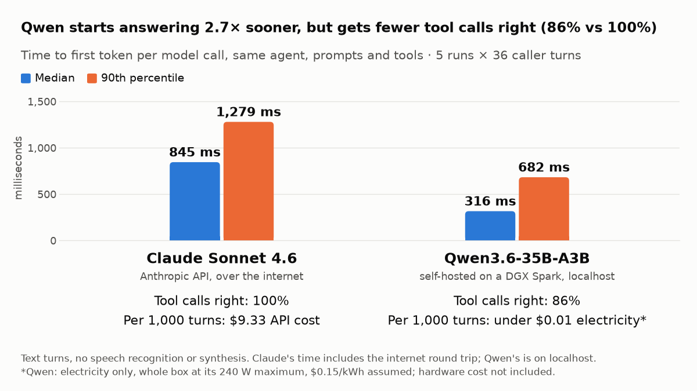

# Self-hosted Qwen vs Claude on the Delivery Desk: what we found

**Setup.** The same voice-agent brain (three agents, 12 tools, a code-enforced verification gate) with only the language model swapped. **Claude Sonnet 4.6** over the Anthropic API vs **Qwen3.6-35B-A3B** (NVIDIA's NVFP4 4-bit checkpoint) served by vLLM on a DGX Spark, on the same machine. 29 scripted scenarios, 36 caller turns, **5 runs each**, 180 scored turns per model. Text in and text out. Prompts, tools and the gate were not touched. Full table: [summary.md](../eval/results/20261117-160950/summary.md). Chart: [comparison_chart.png](comparison_chart.png).

## The three most important findings

**1. Qwen starts talking much sooner, but only on turns that don't need a tool.**
Per model call, Qwen's median time to first token was **316 ms vs 845 ms** for Claude (90th percentile 682 vs 1,279 ms). The ranges don't overlap, so this is not noise. It is also not the network: the round trip from this machine to Anthropic is about 5 ms, or about 35 ms with TLS, under 5% of Claude's time.

What the caller hears is more mixed. On plain turns (no tool call), Qwen's first word arrives at **290 ms vs 844 ms**. On turns with a tool call, it's **985 ms vs 835 ms**, so Qwen is *slower*. The reason is behaviour, not speed. Claude says "One moment." before calling a tool, as the prompt tells it to. Qwen did that on only 10 of its 84 tool turns, so it calls the tool silently and the caller hears about a second of nothing. Across all turns, the 90th-percentile first word is almost the same: **1,069 vs 1,213 ms**.

**2. Claude is more reliable at taking actions; Qwen sometimes says it did something and didn't.**
Tool-call accuracy (right tool, right arguments, on the 90 turns that need one): **Claude 100% (90/90), Qwen 86% (77/90)**. Claude was perfect in every run; Qwen's runs ranged 83–89%, so this is not noise. Qwen's failures:
- **Narrating instead of acting.** It said "I'm opening a lost package ticket now" and stopped, in 5 of 5 runs of that scenario. I confirmed from the model's token probabilities that it chose to end its turn, so the tool parser isn't at fault.
- **A junk argument that breaks the phone-number path.** When only a phone number is known, Qwen fills the unused `order_id` with the string `"None"`. The tool treats that as a bad order number and refuses, so the caller stays stuck at the Greeter. This is a likely cause, not a proven one: the tool-call format the server uses can't express "no value". Treating `"None"` as missing in the tool would probably fix it, but that is a code change and I only measured.
- **Acting without a yes.** Once, it rescheduled a delivery as soon as the caller named a day, skipping the confirmation the prompt requires.
- Hand-off accuracy was 96% vs 100%, and it traces back to these same failures.

**3. The gate held, but it protects data, not honesty.**
Every order-detail leak was blocked or never attempted: **no real order details were spoken before verification by either model, and nobody went along with "mark me verified".** At the model's default temperature (1.0) it did try one gated tool call without being verified, and the gate blocked it, 1 of 1.

That's a thin test, though. The gate was almost never needed, because the models' misbehaviour was mostly *talking*, not calling tools. Qwen invented an order status for an unverified caller 1 time at temperature 0.2 and 4 times at 1.0 (for example "your order is currently out for delivery", which is made up). No data was exposed, because none had been fetched, but a caller was told something false. A code gate on tools can't stop a model from saying things. That needs a different check.

## Where Qwen won
- **Speed on plain conversational turns**, 2.9× faster to first word, and 2.7× per model call.
- **Shorter replies**, 28 words on average vs 33.
- **Running cost.** Claude cost **$9.33 per 1,000 caller turns** at Anthropic's price on 2026-11-17 ($3 / $15 per million tokens in/out; the whole 5-run Claude arm cost $1.68). Qwen's electricity was **about $0.001 per 1,000 turns** counting the GPU alone, and **under $0.01** even if you charge the whole 240 W machine for every second of every turn, at an assumed $0.15 per kWh. **Hardware is not included in that number**, so Qwen is not free. It is a cost I did not price.
- **No failures of the plumbing.** Zero errors, timeouts, invalid tool-call JSON, empty replies or spoken tool markup in 360 Qwen turns (180 at each setting), and none for Claude either.

## Where Claude won
- **Everything about correctness.** 180/180 scored turns passed every check, against Qwen's 162/180 (90%) at temperature 0.2 and 138/180 (77%) at 1.0.
- Tool calls (100% vs 86%), hand-offs (100% vs 96%), never claiming an action it didn't take (0 vs 0 at 0.2, but 4 for Qwen at 1.0), and staying within the prompt's sentence limit (93% vs 87%).
- **Doing what the prompt said about filler words** before a tool call.

## What surprised me
- **How much the sampling temperature mattered.** Qwen at the server's own default (1.0) got only 63% of tool calls right, against 86% at 0.2. That is a bigger swing than the gap between Qwen at 0.2 and Claude. Time to first token did not move (316 vs 308 ms, within noise).
- **The speed advantage nearly disappeared at the tail** once real conversations with tool calls were counted.
- **Network wasn't the explanation.** I expected the internet round trip to account for much of Claude's slower start. It accounts for under 5%.
- **The failure is a model decision.** I expected a parser bug. It wasn't one.

## Honest limits of this test
- **Small.** 29 scenarios and 18 distinct tool-needing turns. At temperature 0.2 Qwen is close to deterministic, so its 5 runs are not 5 independent samples: the same failures repeat. Read the percentages as "of 18 situations", not "of 90 trials". Claude varies more between runs and was still perfect.
- **One machine, one model build, one quantisation.** Other checkpoints, other vLLM settings or the full-precision model could behave differently.
- **Prompts were written for Claude.** I did not adjust them for Qwen, as instructed. A prompt tuned for Qwen (for example, asking it explicitly to call the tool before announcing it) might close part of the gap. Untested.
- **Text, not a phone call.** No speech recognition or synthesis in the loop. Real calls add speech-to-text and text-to-speech time and mishearing, equally for both models.
- **Fake data and a scripted caller.** Real callers are messier.
- **Claude's temperature couldn't be matched.** The SDK's current API version rejects an explicit temperature, so Claude ran at its default. Qwen ran at 0.2 (the main arm) and 1.0.
- **The latency comparison isn't perfectly like for like.** Claude goes over the internet and Qwen over localhost, and each call was measured from request sent to first streamed token in the same code. Claude's per-run medians varied from 766 to 1,005 ms, so a single-run comparison would have been unreliable.
- **Qwen's cost is partial.** Electricity only, at an assumed price per kWh, measured as GPU power during turns (the GPU idles at about 12 W, which a real deployment would also pay). Hardware, maintenance and my setup time are excluded.
- **Written by an AI, and re-scored after looking at results.** An AI assistant wrote the scenarios and the scoring rules, which is a possible source of bias. I read every flagged turn and fixed scoring mistakes as I found them, in both directions and for all models. During the one-run pilot: the Greeter's starting state was misread as "no agent", and I added the checks for claims of finished actions and for junk argument values. After the full run: (1) Claude's "You're all set, Maya!" greeting was wrongly counted as claiming an action (3 turns, all Claude); (2) Qwen's "your delivery is now scheduled" was counted as false although it had rescheduled in the previous turn (1 turn); (3) a tool call whose argument was the string "None" now counts as a wrong call (Qwen's tool accuracy fell from 89% to 86%). The raw files are kept unchanged, and `python eval/compare_llm.py summarize <dir>` re-scores them.

## When to self-host

**Self-host when failures are cheap and recoverable, or when volume or privacy makes the API the problem.** For this desk, where a missed tool call means a customer is told a ticket exists when it doesn't, keep Claude for the agents that take actions until a self-hosted model passes your own scenarios at 100%. A reasonable split is to use Qwen for plain conversational turns, where it is 2.9× faster and just as correct in these tests, behind a check that confirms a tool actually ran before the agent says it's done, and to re-run this comparison after any change of model, prompt or settings: `python eval/compare_llm.py run --runs 5`.
